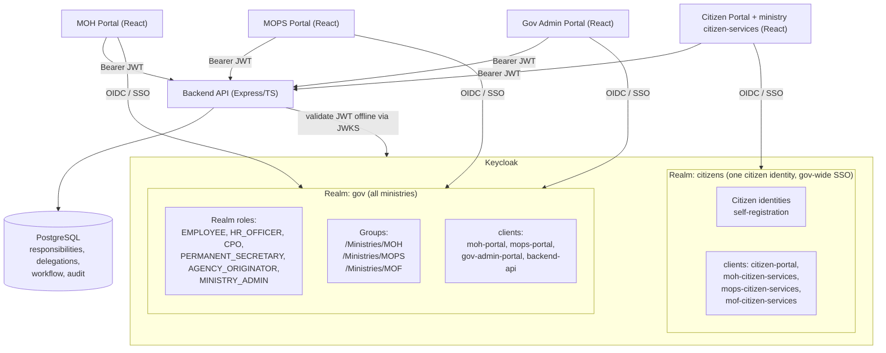

# 01 — Analysis & Architecture Recommendation (Phase 1 & 2)

## Part A — Requirement Analysis (Phase 1)

### A.1 The requirements, reframed as forces on the design

| # | Requirement in the brief | What it actually forces |
|---|--------------------------|-------------------------|
| R1 | Citizens **and** employees exist | Two populations with **opposite** properties (see A.2). Pushes toward *separating* them. |
| R2 | An MOH Permanent Secretary **originates a request inside MOPS** | *Home ministry ≠ operating scope.* Ministry cannot be a hard security wall. Cross-ministry is a **first-class**, not exceptional, requirement. |
| R3 | SSO across Citizen/MOH/MOPS/(Admin) portals | Internal portals must share a session and trust **one** token issuer. Pushes *against* realm-per-ministry. |
| R4 | Employment workflow spans MOH → MOPS with 6 stages and role hand-offs | Authorization depends on **workflow state** and **assignment**, not only on role. That is inherently application data. |
| R5 | Temporary delegation: CPO *acts as* PS for 1 day, auto-expires | Authority that is **time-bound, revocable, and auditable** cannot be a static role baked into a token. |
| R6 | Least privilege, ministry isolation, no privilege escalation | Default-deny per ministry; cross-ministry only by **explicit grant**. |
| R7 | Full auditability ("who, which role, delegated by whom, when") | Need a **business** audit trail that records *effective* role and delegation lineage — Keycloak's admin/login events are not enough. |
| R8 | Scale from 3 → 20–50+ ministries; onboard ministries & staff; staff move between ministries | Per-ministry structures must be **cheap to add and re-parent**. Realm-per-ministry multiplies operational cost linearly. |
| R9 | **Government-wide citizen SSO**: one citizen identity, log in once at the Citizen Portal, reach MOH/MOPS/MOF citizen services with no repeated login; single logout | A **single central citizen realm** with ministry services as **clients** is required. Realm-per-ministry would fragment the citizen into `citizen@moh`/`citizen@mops`/… (explicitly forbidden) and force cross-realm brokering for every hop. Analysed in full in **[07](07-citizen-sso-and-identity-domains.md)**. |
| R10 | A person may be **both** a citizen and an employee | Two *contexts*, kept as two accounts (one per realm) for separation of duties; optionally correlated by national ID at the data layer. See [07 Part C](07-citizen-sso-and-identity-domains.md). |

### A.2 The two populations are fundamentally different

| Property | **Citizens** | **Government employees** |
|----------|--------------|--------------------------|
| Population size | Millions | Thousands–low tens of thousands |
| Onboarding | **Self-registration** | **Provisioned** (HR/LDAP/directory) |
| Identity source | Email / national ID / social IdP | Government directory, `@*.gov.gy` mail |
| Trust level | Low, unverified by default | High, vetted, employment-backed |
| Cross-ministry needs | **None** | **Core** |
| Breach blast radius | Public-facing services | Internal government operations |
| Lifecycle | Long-lived, dormant, self-service reset | Join / transfer / offboard, HR-driven |

Merging these into one realm forces a single registration flow, one password policy, one set of authentication flows, and one breach boundary across radically different risk profiles. **No workflow in the brief ever requires a citizen and an employee to share a session.** So they should be separated.

### A.3 Authorization is multi-dimensional — and only part of it is Keycloak's job

A single access decision in this system is the **conjunction** of six independent questions:

```
1. Authentication      Who is this principal?                         ← Keycloak
2. Role (RBAC)         Do they hold the capability at all?            ← Keycloak (coarse realm roles)
3. Ministry context    Which ministry's data is this, vs. theirs?     ← Application
4. Resource / ReBAC    Is THIS request assigned to them / owned?      ← Application
5. Workflow state      Is the request in a state they may act on?     ← Application
6. Delegation (time)   Are they *acting as* someone right now?        ← Application (live check)
```

**Keycloak can answer #1 and #2. It cannot correctly answer #3–#6**, because those depend on runtime business data (assignment, workflow position, ministry of the record, active delegations) that changes far faster than a token's lifetime and is specific to the resource being touched. Forcing #3–#6 into Keycloak roles or JWT claims is the central anti-pattern this POC must avoid.

### A.4 Risks & ambiguities identified

- **Stale-authority risk.** If responsibilities or delegations are put into the JWT, a revoked or expired grant remains usable until the token expires. **Mitigation:** keep volatile authority out of the token; evaluate it live server-side.
- **Privilege-escalation risk via delegation.** Permanently adding the `PERMANENT_SECRETARY` role to a CPO grants excessive standing authority. **Mitigation:** delegation is a separate, scoped, time-bound record — never a permanent role.
- **Ministry = wall vs. context ambiguity.** The brief explicitly warns that `Ministry = MOH` must **not** imply "can only operate within MOH." **Resolution:** ministry is a *context/scope* attribute, enforced by the app, not a realm boundary.
- **Admin-isolation risk.** In one realm, can an MOH admin edit MOPS users? **Mitigation:** group-scoped fine-grained admin (Keycloak `manage-users` on a ministry subgroup) or delegated admin through the application; never full realm-admin per ministry.
- **Keycloak availability risk.** If Keycloak is down, no one can log in. **Mitigation:** short-lived tokens remain valid until expiry; resource servers validate JWTs **offline** against cached JWKS, so in-flight sessions keep working; run Keycloak clustered/HA in production.
- **Citizen accidentally reaching internal functions.** **Mitigation:** citizens live in a different realm and are never issued tokens with an internal-portal audience.

---

## Part B — Realm Strategy: Options Compared (Phase 2)

The decision hinges on the two hardest requirements: **R2 (cross-ministry responsibility)** and **R3 (SSO + single trust boundary)**. Evaluate each option against them, then against operations and security.

### Option A — Single realm for the entire government (citizens + all employees)

```
Government Realm
├── Citizens
└── Employees ── MOH / MOPS / MOF (as groups)
```

| Dimension | Assessment |
|-----------|-----------|
| Cross-ministry (R2) | ✅ Trivial — one token, one issuer; cross-ministry is pure app authorization. |
| SSO (R3) | ✅ Native across every portal. |
| Ministry isolation | ⚠️ Not a realm boundary; must be enforced in the app (acceptable, see Part C). |
| Admin isolation | ⚠️ Requires fine-grained/group-scoped admin so one ministry can't manage another's users. |
| Citizen vs employee | ❌ **Forces one registration flow, password policy, auth flow, and breach boundary across millions of low-trust and thousands of high-trust users.** |
| Scale to 50 ministries | ✅ Add a group + roles per ministry; no new realm. |
| Blast radius | ❌ One realm compromise or misconfiguration touches citizens *and* all of government. |

**Verdict:** Right for *employees*, wrong to also absorb *citizens*.

### Option B — Separate realm per ministry (+ a citizen realm)

```
Realm: MOH   Realm: MOPS   Realm: MOF   Realm: Citizens
```

| Dimension | Assessment |
|-----------|-----------|
| Security boundary | ✅ Hard isolation between ministries by construction. |
| Cross-ministry (R2) | ❌ **The killer.** MOH's PS has no identity in the MOPS realm. To originate in MOPS you must **identity-broker** MOH→MOPS for every cross-ministry action, or duplicate the user. The "PS of MOH acts in MOPS" case becomes a federation project. |
| **Citizen SSO (R9)** | ❌ **Second killer.** A citizen would need an identity in *each* ministry realm — exactly the forbidden `citizen@moh`/`citizen@mops`/`citizen@mof`. One government-wide citizen ID cannot exist; every ministry hop needs cross-realm brokering, not silent SSO. |
| SSO (R3) | ❌ Tokens from realm MOH are **not valid** at MOPS. Cross-portal SSO needs realm-to-realm brokering; every resource server must trust N issuers. |
| Identity duplication | ❌ A person with responsibilities in 3 ministries exists 3 times; lifecycle (transfer, offboard) must be synchronised across realms. |
| Token validation | ❌ Each API must accept multiple issuers/audiences; harder, more error-prone. |
| Auditing | ❌ No single identity to trace an actor across ministries; audit is fragmented per realm. |
| Delegation across ministries | ❌ Even messier — delegate and delegator may live in different realms. |
| Operational cost (R8) | ❌ Clients, roles, mappers, flows, admins, backups **multiplied by the number of ministries**. 50 ministries = 50 of everything. |
| Onboarding a ministry | ❌ Stand up and secure an entire new realm each time. |

**Verdict:** The isolation it buys is real but is achievable more cheaply at the authorization layer. It **directly breaks** the two hardest requirements (R2, R3) and does not scale operationally. **Rejected.**

### Option C — Hybrid (recommended): `citizens` realm + one `gov` realm

```
Keycloak
├── Realm: citizens      (external, self-registration; Citizen Portal only)
└── Realm: gov           (ALL employees of ALL ministries — one realm)
        Ministries modelled as GROUPS + `home_ministry` attribute:
        /Ministries/MOH,  /Ministries/MOPS,  /Ministries/MOF
        Business roles modelled as REALM ROLES:
        PERMANENT_SECRETARY, CPO, HR_OFFICER, AGENCY_ORIGINATOR, EMPLOYEE …
```

| Dimension | Assessment |
|-----------|-----------|
| Cross-ministry (R2) | ✅ One realm, one token → cross-ministry is a pure app-authorization decision. |
| SSO (R3) | ✅ Native across MOH/MOPS/MOF/Admin portals; single issuer & audience model. |
| **Citizen SSO (R9)** | ✅ One citizen identity in `citizens`; ministry citizen-services are clients → log in once, reach every ministry service, single logout. No per-ministry citizen accounts. |
| Citizen vs employee | ✅ Separated: independent registration, password policy, auth flows, breach boundary, scale. Dual-persona humans get one account per domain (R10). |
| Ministry isolation | ✅ Enforced in the app via `home_ministry` + resource scoping (default-deny). |
| Admin isolation | ✅ Fine-grained group-scoped admin per ministry inside the `gov` realm. |
| Identity duplication | ✅ None — each employee is one identity regardless of how many ministries they operate in. |
| Auditing | ✅ One `sub` per person → clean cross-ministry audit trail. |
| Scale to 50 ministries (R8) | ✅ Onboard a ministry = add one group subtree + its roles; **no new realm.** |
| Blast radius | ✅ Citizen breach ≠ government breach; ministries share a realm but are isolated by app policy + group-scoped admin. |

**Verdict:** ✅ **Recommended.**

---

## Part C — Recommendation & Rationale (not just pros/cons)

### Recommendation: **Hybrid — a dedicated `citizens` realm and a single unified `gov` realm; ministries are groups + attributes inside `gov`, not realms.**

**Why this is the correct architecture for a government-wide system — the reasoning, not the list:**

1. **The system's defining feature is that authority crosses ministry lines.** The flagship scenario — an MOH Permanent Secretary originating an employment request *inside* MOPS and a MOPS CPO later *acting as* the MOPS PS — is not an edge case; it is the point of the system. Realm-per-ministry makes the *normal* operation of the system a cross-realm federation problem. A single `gov` realm makes it an ordinary authorization decision on one token. **Architecture should make the common case simple; realm-per-ministry makes the common case hard.**

2. **Isolation is a property you want at the *authorization* layer, not the *identity* layer.** Realm walls give you isolation you cannot selectively open — but this system's requirement is *selective* openness (MOH's PS *should* reach MOPS, for one specific responsibility, with an audit trail). That is exactly what an application authorization layer expresses well and what realm boundaries express badly. Put isolation where you can also express the exceptions: in the app.

3. **Citizens and employees are different systems wearing the same login button.** They differ in scale by three orders of magnitude, in trust, in onboarding, and in blast radius. Separating them into two realms costs almost nothing (no cross-realm workflow exists between them) and buys independent tuning and a smaller breach boundary. This is the one place a realm boundary earns its keep.

4. **It scales the way government grows.** Government adds ministries and moves staff between them constantly. In the hybrid model, onboarding a ministry is "add a group subtree and a few roles," and a staff transfer is "re-parent one user and swap one attribute." In realm-per-ministry, both are multi-realm migration projects. Over 20–50 ministries the operational difference is decisive.

5. **It keeps Keycloak doing what Keycloak is good at.** Keycloak becomes the stable identity + authentication + coarse-role foundation for the *whole* government, and the volatile, contextual, time-bound decisions (ministry scoping, responsibilities, delegation, workflow) live where they can change safely — in the application. This is the boundary the brief asks us to find, and the hybrid realm model is what lets us draw it cleanly.

### What this recommendation explicitly rejects

- **Not** one realm for *everyone* (citizens must be separate — A.2).
- **Not** a realm per ministry (breaks R2/R3, does not scale — Option B).
- **Not** solving ministry isolation, cross-ministry responsibility, or delegation with Keycloak roles alone (they are business/data decisions — see [02](02-identity-and-authorization-model.md) and [04](04-delegation-and-database-model.md)).

### Diagram — recommended topology



> **Note on Keycloak Organizations:** Keycloak 25+ ships an *Organizations* feature (multi-tenant grouping with per-org IdPs and membership). It is a reasonable *future* substitute for the `/Ministries/*` **group hierarchy** if the government later wants per-ministry federated IdPs. For this POC we model ministries as **groups + a `home_ministry` attribute** because they are universally available, trivially scriptable for import, and map 1:1 to the app's ministry context. The decision is called out in [03](03-keycloak-configuration.md).

Continue to **[02 — Identity & Authorization Model](02-identity-and-authorization-model.md)**.
