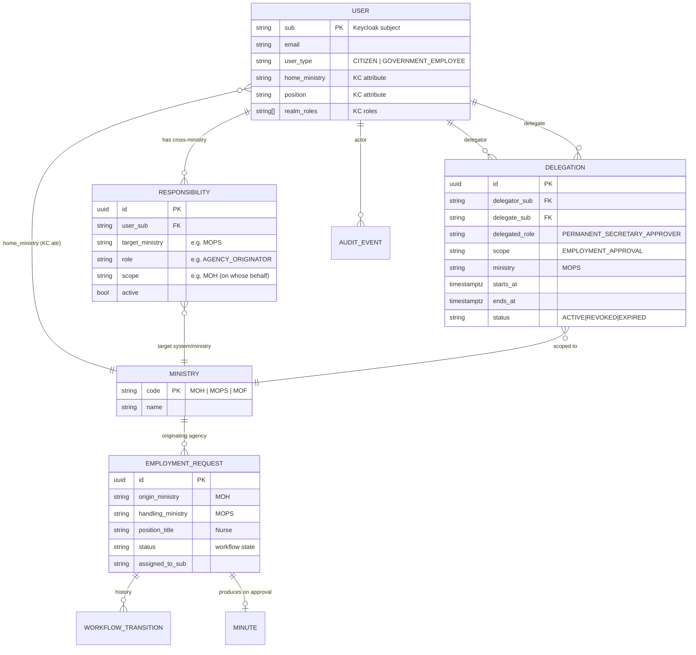

# 02 — Identity & Authorization Model (Phase 3)

## Part A — Entity / Identity Model

### A.1 Where each entity lives (the single most important table in this POC)

| Entity | Owner of truth | Why there |
|--------|----------------|-----------|
| **User** (identity, credentials) | **Keycloak** | Authentication is Keycloak's job. |
| **Ministry** (catalogue) | **App DB** (mirrored as KC groups) | It's reference/business data; KC groups are the *membership* projection. |
| **Home ministry** of a user | **Keycloak** (attribute + group) | A stable fact about the person → belongs on the identity → travels in the token. |
| **Position** (e.g. PERMANENT_SECRETARY) | **Keycloak** (attribute) | Stable organisational fact. |
| **Role** (coarse capability: CPO, HR_OFFICER, AGENCY_ORIGINATOR) | **Keycloak** (realm roles) | Coarse, slow-changing → RBAC in the token. |
| **Responsibility** (cross-ministry: "AGENCY_ORIGINATOR for MOPS, scoped to MOH") | **App DB** | Business grant, ministry-scoped, changes independently of identity. |
| **Delegation** (time-bound "act as") | **App DB** | Temporal, revocable, auditable — must never be a token claim. |
| **Application / Client** | **Keycloak** (clients) | OIDC registration. |
| **Workflow** (EmploymentRequest, transitions, minute) | **App DB** | Pure business state. |
| **Permission** (fine-grained, per-resource/state) | **App DB / policy code** | Depends on resource + workflow state + delegation. |
| **Audit event** | **App DB** | Must capture *effective* role & delegation lineage. |

> **Rule of thumb:** *A stable fact about **who the person is** → Keycloak & token. A fact about **what they may do to a specific resource right now** → application.*

### A.2 Entity-relationship diagram



### A.3 Improved identity model (challenging the brief's example)

The brief's example JSON mixes *stable identity* with *dynamic business responsibility*. We split it into two resolved layers. **Only the first layer is asserted by Keycloak / carried in the JWT.**

**Layer 1 — Identity assertion (from Keycloak, in the token):**
```json
{
  "sub": "b3f1...-uuid",
  "email": "ps@moh.gov.gy",
  "user_type": "GOVERNMENT_EMPLOYEE",
  "home_ministry": "MOH",
  "position": "PERMANENT_SECRETARY",
  "realm_roles": ["EMPLOYEE", "PERMANENT_SECRETARY", "AGENCY_ORIGINATOR"]
}
```

**Layer 2 — Authorization context (resolved by the app per request, NOT in the token):**
```json
{
  "responsibilities": [
    { "system": "MOPS", "role": "AGENCY_ORIGINATOR", "onBehalfOf": "MOH", "active": true }
  ],
  "activeDelegations": [
    // e.g. when this user is a delegate today:
    // { "actingAs": "PERMANENT_SECRETARY_APPROVER", "delegatedBy": "ps@mops.gov.gy",
    //   "ministry": "MOPS", "scope": "EMPLOYMENT_APPROVAL",
    //   "delegationId": "...", "expiresAt": "2026-08-12T23:59:00Z" }
  ]
}
```

The application computes the **effective authority** = Layer 1 ⊕ Layer 2 at the moment of each request. Because Layer 2 is never in the token, revoking a responsibility or expiring a delegation takes effect **immediately**, with no token refresh.

---

## Part B — Authorization Model (the six layers)

### B.1 Layered decision pipeline (matches brief §20)

```
Request with Bearer JWT
        │
 ┌──────▼───────────────────────────────────────────────────────────────┐
 │ 1. AUTHENTICATION        Validate JWT offline (JWKS): sig, iss, aud,   │  Keycloak-issued,
 │                          exp, azp. Reject if invalid.                  │  app-verified
 ├───────────────────────────────────────────────────────────────────────┤
 │ 2. RBAC                  Does user hold the required realm role?       │  from token
 │                          (CPO? HR_OFFICER? PERMANENT_SECRETARY? …)     │
 ├───────────────────────────────────────────────────────────────────────┤
 │ 3. MINISTRY-BASED        Is resource.ministry == user.home_ministry?   │  app: token attr
 │                          If not, fall through to layer 5.              │  vs resource data
 ├───────────────────────────────────────────────────────────────────────┤
 │ 4. RESOURCE-BASED        Is this resource assigned to / owned by the   │  app: DB lookup
 │    (ReBAC)               user, and in a workflow state they may act on?│
 ├───────────────────────────────────────────────────────────────────────┤
 │ 5. CROSS-MINISTRY        Does the user hold an active RESPONSIBILITY   │  app: DB lookup
 │                          for resource.ministry (e.g. AGENCY_ORIGINATOR │
 │                          for MOPS on behalf of MOH)?                    │
 ├───────────────────────────────────────────────────────────────────────┤
 │ 6. DELEGATION            Is there an ACTIVE, in-window delegation       │  app: DB lookup,
 │                          making the user act-as the required role for  │  live time check
 │                          this scope/ministry right now?                │
 └──────┬────────────────────────────────────────────────────────────────┘
        ▼
   ALLOW (stamp audit with effectiveRole + delegatedBy) or DENY
```

**Default-deny.** A request is allowed only if *some* layer grants it. Ministry isolation is the default: without a matching home ministry (3), responsibility (5), or delegation (6), a user cannot touch another ministry's resource even if their role (2) matches.

### B.2 The five authorization concepts, mapped

| Concept (brief §18.4) | Where enforced | Mechanism |
|-----------------------|----------------|-----------|
| **Authentication** | Keycloak → app verifies | OIDC + offline JWT validation |
| **Role-Based Access Control** | Keycloak roles, checked in app | `realm_roles` claim → `requireRole()` middleware |
| **Resource-Based Access Control** | Application | ownership/assignment + workflow-state guards |
| **Ministry-Based Access Control** | Application | `home_ministry` claim vs `resource.ministry` |
| **Cross-Ministry Authorization** | Application | `responsibilities` table lookup |
| **Delegation** | Application | `delegations` table, live time-window check |

### B.3 Worked example — MOPS PS approval, normally vs delegated

```
POST /employment-requests/REQ-1001/approve

Actor = ps@mops.gov.gy (normal):
  1 auth ✅   2 role PERMANENT_SECRETARY ✅   3 ministry MOPS==MOPS ✅
  4 request in state PENDING_PS_APPROVAL & handling_ministry MOPS ✅  → ALLOW
  audit: effectiveRole=PERMANENT_SECRETARY, delegatedBy=null

Actor = cpo@mops.gov.gy (PS is absent; delegation active):
  1 auth ✅   2 role CPO (not PS) — RBAC alone would DENY
  6 delegation: ACTIVE PERMANENT_SECRETARY_APPROVER, scope EMPLOYMENT_APPROVAL,
     ministry MOPS, now ∈ [starts_at, ends_at] ✅  → ALLOW
  audit: effectiveRole=PERMANENT_SECRETARY_APPROVER, delegatedBy=ps@mops.gov.gy, delegationId=…

Actor = cpo@mops.gov.gy (after 2026-08-12 23:59):
  6 delegation: none in-window  → DENY (automatic expiry, no token change)
```

---

## Part C — JWT / Claims Design

### C.1 Principle: a *thin* token

The token asserts **identity + coarse role + organisational context** and nothing else. Everything dynamic is resolved server-side. This is what prevents stale-authority bugs and keeps tokens small.

**Access token (claims we add via protocol mappers) — what SHOULD be there:**
```json
{
  "sub": "b3f1...-uuid",
  "iss": "https://keycloak/realms/gov",
  "aud": "backend-api",
  "azp": "mops-portal",
  "exp": 1760000300,
  "iat": 1760000000,
  "preferred_username": "ps.moh",
  "email": "ps@moh.gov.gy",
  "email_verified": true,
  "user_type": "GOVERNMENT_EMPLOYEE",
  "home_ministry": "MOH",
  "position": "PERMANENT_SECRETARY",
  "realm_access": { "roles": ["EMPLOYEE", "PERMANENT_SECRETARY", "AGENCY_ORIGINATOR"] }
}
```

### C.2 What must **NOT** be in the JWT (and why) — challenging the brief's example

The brief's example token has `"responsibilities": []`. **We deliberately reject putting responsibilities or delegations in the token:**

| Would-be claim | Why it's excluded |
|----------------|-------------------|
| `responsibilities` | Cross-ministry grants change independently of login; a token minted before a grant/revoke would be wrong until it expires. Resolve live from DB. |
| `delegations` / `actingAs` | **The critical one.** A delegation can be revoked mid-day or expire at 23:59. A token issued at 09:00 with a delegation claim would keep working after revocation/expiry. Delegation **must** be evaluated per request. |
| fine-grained permissions | Depend on resource + workflow state, which the token cannot know. |
| assigned request IDs / workflow data | Volatile business data; belongs in the API responses, not identity. |

> **Summary of the split**
>
> | Belongs in… | Contents |
> |-------------|----------|
> | **JWT** | sub, email, user_type, home_ministry, position, realm roles, standard OIDC (iss/aud/exp/azp) |
> | **Keycloak** | credentials, group membership, the above attributes/roles, sessions |
> | **Application DB** | responsibilities, delegations, workflow state, ownership, audit |
> | **Authorization Service (app layer)** | the live evaluation combining token + DB into an ALLOW/DENY, and stamping the effective role |

### C.3 Token lifetime & the "stale claim" answer

- **Access token:** short (≈5 min). Safe to keep short because the token only carries *stable* facts; we are not relying on it for volatile authority.
- **Refresh token:** longer (≈30 min idle / 8 h max), rotated.
- **Role change** (e.g. promotion): reflected on next token refresh (≤5 min) — acceptable for coarse roles.
- **Delegation change / responsibility change:** reflected **instantly**, because these are never in the token — the app reads them live on every request.
- **Revocation:** back-channel logout + short access-token TTL; the resource server can additionally consult a short-TTL introspection/allowlist for high-value actions if required.

Continue to **[03 — Keycloak Configuration](03-keycloak-configuration.md)**.
