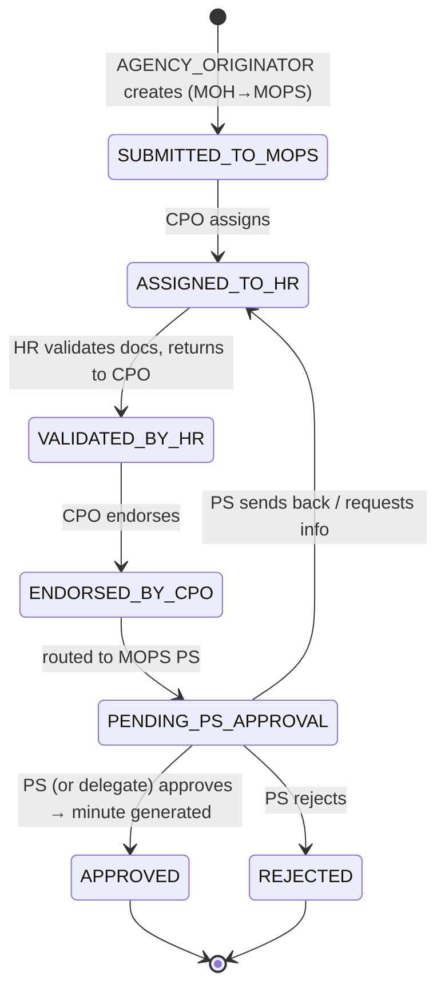

# 04 — Delegation & Database Model (Phase 3)

## Part A — Delegation design

### A.1 Requirements restated (brief §8/§9)

Delegation must be **temporary, explicitly assigned, time-bound, auditable, revocable, restricted to specific responsibilities, and restricted to appropriate resources** — and it must **auto-expire** without leaving residual authority. The brief explicitly forbids permanently adding the PS role to the CPO.

### A.2 Where delegation lives: **Application DB + live evaluation** (not Keycloak, not the JWT)

| Candidate | Verdict | Reason |
|-----------|---------|--------|
| Permanent Keycloak role on CPO | ❌ | Becomes permanent privilege — the exact anti-pattern. |
| Temporary Keycloak role added/removed by a cron job | ❌ | (a) Race with token lifetime — an issued JWT keeps the role until it expires even after removal; (b) needs a reliable scheduler to remove; (c) no business audit (who/why). |
| Delegation claim inside the JWT | ❌ | Stale-authority hole: a token minted at 09:00 still "acts as PS" after a 12:00 revoke. |
| Keycloak Authorization Services time policy | ⚠️ | Possible but awkward for "act as principal", still embeds grants in RPTs, and needs business context Keycloak lacks. |
| **App DB record + live check on every request** | ✅ | Time window checked at decision time → **automatic expiry**; revocation is instant; full audit lineage; scoped to role+ministry+resource. |

### A.3 Data model

```sql
CREATE TABLE delegations (
  id              UUID PRIMARY KEY DEFAULT gen_random_uuid(),
  delegator_sub   TEXT NOT NULL,               -- who gave the authority (PS of MOPS)
  delegator_email TEXT NOT NULL,
  delegate_sub    TEXT NOT NULL,               -- who receives it (CPO of MOPS)
  delegate_email  TEXT NOT NULL,
  delegated_role  TEXT NOT NULL,               -- 'PERMANENT_SECRETARY_APPROVER'
  scope           TEXT NOT NULL,               -- 'EMPLOYMENT_APPROVAL'
  ministry        TEXT NOT NULL,               -- 'MOPS'  (delegation is ministry-scoped)
  starts_at       TIMESTAMPTZ NOT NULL,
  ends_at         TIMESTAMPTZ NOT NULL,
  reason          TEXT NOT NULL,
  status          TEXT NOT NULL DEFAULT 'ACTIVE',  -- ACTIVE | REVOKED | EXPIRED
  created_by_sub  TEXT NOT NULL,
  created_at      TIMESTAMPTZ NOT NULL DEFAULT now(),
  revoked_by_sub  TEXT,
  revoked_at      TIMESTAMPTZ,
  CONSTRAINT valid_window CHECK (ends_at > starts_at)
);
CREATE INDEX idx_deleg_active ON delegations (delegate_sub, ministry, scope, status);
```

### A.4 Authorization mechanism — the live check

A delegation is **effective right now** for a user/action iff:

```
status = 'ACTIVE'
AND delegate_sub = current_user.sub
AND now() BETWEEN starts_at AND ends_at
AND ministry = resource.handling_ministry
AND scope    = required_scope(action)          -- e.g. approve → EMPLOYMENT_APPROVAL
AND delegated_role grants the role the action requires  (PERMANENT_SECRETARY_APPROVER ⇒ PS approval)
```

- **Auto-expiry:** because the window is checked at decision time, at 23:59:01 the same query returns nothing → authority is gone. No job required for correctness.
- **Optional sweeper:** a scheduled job flips `ACTIVE`→`EXPIRED` for `ends_at < now()` **only for reporting/cleanliness**; it is not on the security path.
- **Revocation:** set `status='REVOKED'`, stamp `revoked_by/at`. Instant, because the next request's check fails.
- **Auditability:** every action taken under a delegation records `effective_role`, `delegated_by`, and `delegation_id` in `audit_events` (Part B).

### A.5 Delegation lifecycle

```mermaid
stateDiagram-v2
    [*] --> ACTIVE: created (starts_at..ends_at)
    ACTIVE --> EXPIRED: now() > ends_at  (auto at check time; sweeper for reporting)
    ACTIVE --> REVOKED: delegator/admin revokes
    EXPIRED --> [*]
    REVOKED --> [*]
```



### A.6 Who may create a delegation (guardrails against escalation)

- Only a user **holding** the role being delegated (the MOPS PS) — or a `MINISTRY_ADMIN` for that ministry — may create it.
- `ministry` must equal the delegator's authority ministry; `delegated_role`/`scope` must come from an allow-list.
- A delegate cannot re-delegate (no transitive delegation in the POC).
- Max window length enforced (e.g. ≤ 14 days) to keep "temporary" honest.

---

## Part B — Full application database schema

```sql
-- Reference data
CREATE TABLE ministries (
  code TEXT PRIMARY KEY,          -- MOH, MOPS, MOF
  name TEXT NOT NULL
);

-- Optional cache/mirror of minimal identity (populated from JWT on first sight);
-- Keycloak remains the source of truth for identity.
CREATE TABLE user_profiles (
  sub           TEXT PRIMARY KEY,
  email         TEXT NOT NULL,
  user_type     TEXT NOT NULL,
  home_ministry TEXT REFERENCES ministries(code),
  position      TEXT,
  last_seen_at  TIMESTAMPTZ
);

-- Cross-ministry responsibilities (business grants)
CREATE TABLE responsibilities (
  id              UUID PRIMARY KEY DEFAULT gen_random_uuid(),
  user_sub        TEXT NOT NULL,
  target_ministry TEXT NOT NULL REFERENCES ministries(code),  -- system they may act in (MOPS)
  role            TEXT NOT NULL,                               -- AGENCY_ORIGINATOR
  on_behalf_of    TEXT REFERENCES ministries(code),           -- MOH
  active          BOOLEAN NOT NULL DEFAULT true,
  created_at      TIMESTAMPTZ NOT NULL DEFAULT now()
);

-- Delegations (see Part A.3)

-- Workflow: employment requests
CREATE TABLE employment_requests (
  id                 UUID PRIMARY KEY DEFAULT gen_random_uuid(),
  reference          TEXT UNIQUE NOT NULL,          -- REQ-1001
  position_title     TEXT NOT NULL,                 -- Nurse
  origin_ministry    TEXT NOT NULL REFERENCES ministries(code),   -- MOH (agency)
  handling_ministry  TEXT NOT NULL REFERENCES ministries(code),   -- MOPS
  status             TEXT NOT NULL,                 -- see state machine
  created_by_sub     TEXT NOT NULL,                 -- the Agency Originator
  assigned_to_sub    TEXT,                          -- current handler (e.g. HR officer)
  details            JSONB NOT NULL DEFAULT '{}',
  created_at         TIMESTAMPTZ NOT NULL DEFAULT now(),
  updated_at         TIMESTAMPTZ NOT NULL DEFAULT now()
);

CREATE TABLE workflow_transitions (
  id                 UUID PRIMARY KEY DEFAULT gen_random_uuid(),
  request_id         UUID NOT NULL REFERENCES employment_requests(id),
  from_status        TEXT,
  to_status          TEXT NOT NULL,
  action             TEXT NOT NULL,                 -- ASSIGN, VALIDATE, ENDORSE, APPROVE…
  actor_sub          TEXT NOT NULL,
  effective_role     TEXT NOT NULL,                 -- role actually used
  delegated_by_sub   TEXT,                          -- null unless via delegation
  delegation_id      UUID REFERENCES delegations(id),
  note               TEXT,
  created_at         TIMESTAMPTZ NOT NULL DEFAULT now()
);

CREATE TABLE minutes (
  id            UUID PRIMARY KEY DEFAULT gen_random_uuid(),
  request_id    UUID NOT NULL REFERENCES employment_requests(id),
  document      JSONB NOT NULL,                     -- position, employee, effective date, approver…
  generated_at  TIMESTAMPTZ NOT NULL DEFAULT now()
);

-- Business audit trail (answers all of brief §22)
CREATE TABLE audit_events (
  id                UUID PRIMARY KEY DEFAULT gen_random_uuid(),
  actor_sub         TEXT NOT NULL,
  actor_email       TEXT NOT NULL,
  actor_ministry    TEXT,                           -- home ministry of actor
  action            TEXT NOT NULL,                  -- APPROVE_EMPLOYMENT_REQUEST…
  resource_type     TEXT NOT NULL,                  -- EMPLOYMENT_REQUEST, DELEGATION…
  resource_ref      TEXT,                           -- REQ-1001
  effective_role    TEXT NOT NULL,                  -- role used for THIS action
  delegated         BOOLEAN NOT NULL DEFAULT false,
  delegated_by_sub  TEXT,
  delegation_id     UUID,
  result            TEXT NOT NULL,                  -- SUCCESS | DENIED
  ip                TEXT,
  session_id        TEXT,
  created_at        TIMESTAMPTZ NOT NULL DEFAULT now()
);
```

### B.1 Employment-request state machine (workflow model)



### B.2 Action → required authority matrix (enforced in `backend-api`)

| Action / endpoint | Required role (RBAC) | Ministry rule | Delegatable? |
|-------------------|----------------------|---------------|--------------|
| `POST /employment-requests` | `AGENCY_ORIGINATOR` | via **responsibility** for `handling_ministry` | no |
| `POST /:id/assign` | `CPO` | actor home == handling_ministry | no |
| `POST /:id/validate` | `HR_OFFICER` | assigned_to == actor & handling_ministry | no |
| `POST /:id/endorse` | `CPO` | actor home == handling_ministry | no |
| `POST /:id/approve` | `PERMANENT_SECRETARY` | actor home == handling_ministry | **yes → `PERMANENT_SECRETARY_APPROVER`** |
| `POST /:id/reject` `/send-back` | `PERMANENT_SECRETARY` | actor home == handling_ministry | **yes** |
| `POST /delegations` | holder of delegated role or `MINISTRY_ADMIN` | delegator ministry | — |

This matrix is the concrete contract the implementation (Phase 4) and tests (Phase 5) will honour.

Continue to **[05 — Answers to the 24 Key Questions](05-answers-to-key-questions.md)**.
