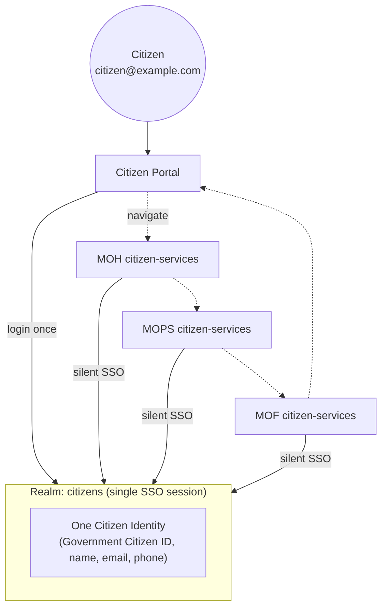

# 07 — Citizen SSO & the Two Identity Domains

> This document folds the **government-wide Citizen SSO** requirement into the architecture. **Headline: it does not change the recommendation — it strengthens it.** The hybrid two-realm model already maps 1:1 onto the "two identity domains" this requirement describes, and Citizen SSO becomes a *decisive* new argument against realm-per-ministry.

## Part A — How Citizen SSO lands on the recommended architecture

The recommended model already has a dedicated **`citizens` realm** holding **one government-wide citizen identity** per person. Citizen SSO is achieved by making each ministry's **citizen-facing service a client in that same realm** — not a new realm and not a new identity.

```
Realm: citizens   (ONE identity per citizen — the "Government Citizen ID")
   ├── client: citizen-portal          (central entry point)
   ├── client: moh-citizen-services    (Health services, applications)
   ├── client: mops-citizen-services   (Scholarship, job applications)
   ├── client: mof-citizen-services    (Tax, financial services)
   └── client: <future-ministry>-citizen-services   ← onboarding = add a client
```

Because every ministry citizen-service is a client in the **same realm**, the browser holds **one realm SSO session**. Moving Citizen Portal → MOH → MOPS → MOF triggers silent SSO (Auth Code + PKCE with an existing session) at each client — **no repeated login**. This is standard OIDC multi-client SSO; nothing custom is required.



**This is the same architecture as before** — the two-realm split — now shown to serve *both* domains:

```
                    Government IAM (one Keycloak)
                              │
              ┌───────────────┴────────────────┐
        Realm: citizens                    Realm: gov
        (one citizen identity)             (all employees, all ministries)
              │                                  │
        Citizen Portal + ministry           Internal ministry portals
        citizen-service clients             (moh/mops/gov-admin) + backend-api
              │                                  │
        SSO across MOH/MOPS/MOF              SSO across MOH/MOPS/admin
        citizen services                    employee workflows
```

## Part B — Why realm-per-ministry is now *doubly* disqualified

Citizen SSO adds a second, independent reason to reject Option B:

| If each ministry had its own realm… | Consequence |
|-------------------------------------|-------------|
| A citizen would need an identity in each ministry realm | Produces exactly the **forbidden** `citizen@moh`, `citizen@mops`, `citizen@mof` duplicates. |
| SSO across ministry services | Impossible without **cross-realm identity brokering/federation** for every ministry — heavyweight and re-prompts. |
| Citizen moves MOH → MOPS → MOF | Each hop crosses a realm boundary → brokering handshake, not silent SSO. |
| "One government-wide citizen ID" | Cannot exist; identity is fragmented per realm. |

So the same conclusion holds from the *citizen* side that we reached from the *employee* side: **a single central realm per domain is required; realm-per-ministry breaks the core requirement.**

## Part C — The genuinely new question: a person who is *both* a citizen and an employee

The requirement asks how Keycloak should handle a government employee who is also a citizen, and warns against creating duplicate identities "unless there is a strong architectural reason."

**Decision: two accounts — one per realm — because these are two *contexts/personas*, not a duplicated single identity. There is a strong architectural reason.**

### Why this is *not* the "duplicate identity" the brief warns against

The brief's prohibition is about **fragmenting one citizen across ministries** (`citizen@moh` vs `citizen@mops` for the *same citizen role*). That is bad because it splits *one relationship* (citizen ↔ government) into many. Our case is the opposite: **one human has two genuinely different relationships with government** —

| | As a citizen | As an employee |
|--|--------------|----------------|
| Relationship | Member of the public using public services | Staff member with internal authority |
| Realm | `citizens` | `gov` |
| Onboarding | Self-registration | HR-provisioned, vetted |
| Trust / data | Own applications only | Internal workflows, other people's data |
| Authorization | Resource ownership | Roles, ministry, delegation |

These are **two principals**, and keeping them separate is a *security feature*, not an accident:

1. **Separation of duties / blast radius.** A compromised citizen self-service login must not carry an employee's internal authority, and vice-versa. One merged identity would collapse that boundary.
2. **Least privilege / clean sessions.** John Doe applying for his child's scholarship should act as a *citizen*, with a citizen session and citizen token audience — not accidentally wielding his MOH employee role. Distinct realms make the active persona explicit.
3. **Independent lifecycle.** He may leave MOH employment but remain a citizen forever. Offboarding the employee account must not touch the citizen account.
4. **Auditability.** Every action is unambiguously attributable to the citizen persona or the employee persona.

### Considered and rejected: one merged identity in a single realm

Putting both `CITIZEN` and employee roles on one identity in one realm was rejected because it (a) destroys the citizen/employee security boundary we deliberately created, (b) forces millions of citizens and thousands of employees into one realm with one password/MFA/breach boundary, and (c) makes "which persona am I acting as right now?" ambiguous on every request.

### If a unified *view of the human* is ever needed

Link the two accounts at the **data layer**, not the auth layer: store a shared **national ID / person reference** as an attribute on both accounts. A back-office identity-resolution service can then answer "these two accounts are the same person" for reporting or investigation — **without** merging the login-time principals or their sessions. This keeps SSO and authorization clean while still allowing a joined-up citizen record where policy requires it.

> **Summary:** one human → up to two accounts (one per domain), each a first-class identity in its realm, optionally correlated by national ID at the data layer. This is deliberate separation, not accidental duplication.

## Part D — Citizen authorization: SSO ≠ access

Authentication says *who the citizen is*; it must never imply *what they can access*. The `CITIZEN` role only asserts "this is a citizen" — it is **not** sufficient to read a specific record.

**Two authorization checks apply to every citizen request, in the application:**

1. **Resource ownership (citizen data isolation).** `GET /applications/123` must verify `application.owner_sub == token.sub`. Citizen A can read Citizen A's data; never Citizen B's. This is the same resource-based authorization principle from [02](02-identity-and-authorization-model.md), applied to citizen-owned records.
2. **Ministry/service scoping (ministry independence).** Each ministry citizen-service enforces its *own* rules. An MOH health application follows MOH rules; an MOPS scholarship follows MOPS rules — even though it's the same identity and the same SSO session.

```
GET /applications/123
   token valid (citizens realm) ✅  →  has CITIZEN role ✅
   → application 123 owner_sub == token.sub ?  ── no ──►  403 (not your data)
   → yes ──► ministry-service rule for this record type ──► ALLOW
```

**Never authorize on role presence alone.** The backend is the source of truth; the citizen portals only adjust UX.

## Part E — SSO mechanics, logout, and sessions

| Concern | Mechanism |
|---------|-----------|
| **One login, many services** | All citizen services are clients in the `citizens` realm → one realm SSO session → silent Auth Code + PKCE at each client. |
| **Move between services** | Existing realm session satisfies each new client's `/authorize` without credentials. |
| **Return to Citizen Portal** | Still authenticated — same session. |
| **Single logout** | OIDC **RP-initiated logout** on the portal ends the realm SSO session; **back-channel logout** notifies the other citizen-service clients so the citizen is logged out everywhere at once. |
| **Session expiration** | The `citizens` realm has its own SSO idle/max lifetimes, tuned independently of `gov`. Short access tokens + refresh rotation as elsewhere. |
| **Token audience** | Citizen tokens target citizen-service audiences only; they can **never** satisfy an internal `backend-api` (employee) check — enforced by audience + issuer. |

## Part F — Backend handling of two issuers (one API, two domains)

The backend validates tokens from **both** realms and tags each request with an **identity domain** derived from the issuer:

```
iss = .../realms/citizens  → identityDomain = CITIZEN   → citizen endpoints (own-data only)
iss = .../realms/gov       → identityDomain = EMPLOYEE  → internal workflow endpoints
```

- Citizen endpoints reject `EMPLOYEE` tokens and vice-versa (issuer/audience mismatch).
- This keeps a single backend for the POC while preserving a hard boundary between the two identity domains. (In production these could be separate resource servers; the principle is identical.)

## Part G — Scaling Citizen SSO to 20–50+ ministries

Onboarding a ministry's citizen services = **add one client** to the `citizens` realm (and a route/module in the citizen backend). SSO extends to it automatically; the citizen identity is unchanged; no new realm, no new citizen account. Same O(1) onboarding story as the employee side.

## Part H — Answers to the new evaluation questions

- **Can a single citizen identity authenticate across all ministry applications?** Yes — one identity in the `citizens` realm; ministry services are clients; SSO is native.
- **How does SSO work if each ministry has a separate realm?** It doesn't cleanly — it needs cross-realm brokering and creates the forbidden per-ministry citizen identities.
- **Citizen moves MOH → MOPS → MOF?** Same realm session; silent SSO at each client; no re-login.
- **Would separate realms require federation/brokering?** Yes — for every ministry, and it fragments the citizen identity.
- **Would a central citizen realm be required?** Yes — that is precisely the `citizens` realm we recommend.
- **How do employee and citizen identities coexist?** Separate realms → separate principals (Part C); a dual-role human has two accounts, optionally linked by national ID at the data layer.
- **SSO across multiple clients?** Shared realm SSO session + OIDC Auth Code/PKCE per client.
- **Logout across apps?** RP-initiated + back-channel single logout on the realm session (Part E).
- **Session expiration?** Per-realm SSO idle/max lifetimes; short access tokens + rotation.
- **Citizen authorization ministry-specific?** Yes — resource ownership + per-ministry service rules in the app (Part D).
- **Scale to 20–50+ ministries?** Add a client per ministry per domain; no new realm (Part G).

## Part I — Acceptance criteria coverage

| Acceptance criterion | How the architecture satisfies it |
|----------------------|-----------------------------------|
| **Citizen SSO** (one account → one auth → many services → no repeated login) | Single `citizens` realm, ministry services as clients, silent SSO (Part A). |
| **Citizen isolation** (A sees A, not B) | Resource-ownership check `owner_sub == token.sub` on every citizen record (Part D). |
| **Ministry independence** | Each citizen-service client enforces its own ministry rules (Part D). |
| **Government employee isolation** | `gov` realm + default-deny ministry scoping ([02](02-identity-and-authorization-model.md)). |
| **Cross-ministry employee responsibility** | `AGENCY_ORIGINATOR` role + `responsibilities` table ([04](04-delegation-and-database-model.md)). |
| **Temporary delegation** | `delegations` table, live-evaluated, auto-expiring ([04](04-delegation-and-database-model.md)). |

All six hold **simultaneously** under the single hybrid model — the design optimises for neither citizen SSO nor employee workflow alone.
